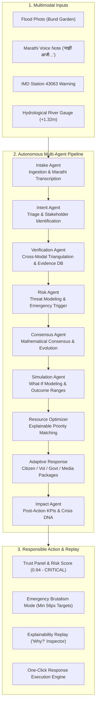

# ImpactOS: From Chaos To Action

**ImpactOS** is an autonomous AI emergency decision-support operating system that turns messy, multimodal crisis information into verified, explainable, actionable response plans.


---

## Demo Scenario: Pune Mutha River Flood Inundation
- **Disaster Visual**: Photograph of submerged banks and river wall along Bund Garden corridor (`18.542457, 73.883776`), Mutha River, Pune.
- **Audio Distress Note**: Marathi voice recording (*"माझी आजी अडकली आहे आणि ती बाहेर पडू शकत नाही"* — trapped elderly resident in ground-floor residence).
- **Meteorological & Sensor Feed**: Official IMD Station 43063 (Shivajinagar/Pune) alert + Mutha River gauge at 7.82m (+1.32m over danger mark, 35,400 cusecs Khadakwasla Dam release).
- **Output**: Verified incident classification, critical risk assessment, uncertainty bounds (`82% - 96%`), 3 simulated response scenarios, explainable LP resource allocation, and bilingual draft response orders (English + Marathi).

---

## System Architecture



---

## Monorepo Layout

```
impactos/
├── apps/
│   ├── api/                          # FastAPI Backend
│   │   ├── app/
│   │   │   ├── main.py               # Application entrypoint & CORS
│   │   │   ├── config.py             # Settings & environment variables
│   │   │   ├── db/                   # Async SQLAlchemy models (6 core tables)
│   │   │   ├── schemas/              # Pydantic v2 schemas
│   │   │   ├── agents/               # Intake, Intent, Verify, Risk, Consensus, Sim, Impact
│   │   │   ├── services/             # Pipeline, Optimizer, Adaptive Response, Crisis DNA
│   │   │   └── routers/              # Endpoints: /incidents, /simulate, /optimize, /actions
│   │   ├── demo_assets/              # Bund Garden photo, Marathi audio, weather warning
│   │   └── tests/                    # Automated verification test suite
│   └── web/                          # Next.js 15 App Router Frontend
│       ├── app/
│       │   ├── page.tsx              # Command Center Bento Grid & Decision Graph
│       │   ├── landing/page.tsx      # Scroll-driven storytelling narrative
│       │   └── globals.css           # Spatial UI, liquid glass accents & brutalism
│       ├── components/               # Bento tiles, Mapbox grid, Copilot, Modals
│       └── public/                   # PWA manifest, demo assets
├── docs/
│   ├── architecture.md               # Technical architecture & schema specifications
│   └── demo_script.md                # Step-by-step 3-minute executive presentation script
├── run_all.sh                        # Monorepo concurrent startup script
└── README.md
```

---

## Quickstart & Launch Commands

### 1. Launch All Services (One Command)
```bash
cd /path/to/impactos
chmod +x run_all.sh
./run_all.sh
```
- **Web Command Center:** `http://localhost:3000`
- **Storytelling Landing Page:** `http://localhost:3000/landing`
- **Backend API & Swagger Docs:** `http://localhost:8000/docs`

### 2. Run Automated Verification Test Suite
```bash
cd apps/api
.venv/bin/python -m unittest discover -s tests -v
```

### 3. Review 3-Minute Presentation Demo Script
See [`docs/demo_script.md`](docs/demo_script.md) for the exact walkthrough script covering the Pune flood scenario.

---

## Deploy with GitHub, Vercel, and Render

The repository is a monorepo: deploy the **Next.js web app to Vercel** and deploy
the **FastAPI API separately**. Vercel does not run this API as part of the
Next.js app.

### 1. Push the project to GitHub

Create a GitHub repository, then from the project root:

```bash
git init
git add .
git commit -m "Prepare ImpactOS deployment"
git branch -M main
git remote add origin https://github.com/YOUR-USER/YOUR-REPOSITORY.git
git push -u origin main
```

If this project is already a Git repository, skip `git init` and add/commit/push
your changes using your normal workflow. Never commit `.env` files or real API
keys. The included GitHub Actions workflow runs web lint, type-check and build,
plus API lint and tests, for pushes and pull requests.

### 2. Deploy the web app to Vercel

1. Import the GitHub repository in Vercel.
2. Set **Root Directory** to `apps/web` and leave the framework as Next.js.
   `apps/web/vercel.json` identifies the framework.
3. Add the environment variable `NEXT_PUBLIC_API_URL` with the public base URL
   of the deployed API (for example, `https://your-api.example.com`). Set it for
   Preview and Production environments as needed.
4. Deploy. Vercel builds from `apps/web/package-lock.json`; no API key belongs
   in the Vercel web project.

The web app's `NEXT_PUBLIC_API_URL` is embedded into browser JavaScript, so it
must contain only the public API URL. Do not put `GEMINI_API_KEY` or other
secrets in `NEXT_PUBLIC_*` variables.

### 3. Deploy the API

The repository includes a Render Blueprint (`render.yaml`) and API Dockerfile.
In Render, create a new Blueprint from the GitHub repository and configure:

- `GEMINI_API_KEY`: a secret entered in Render, never committed to GitHub.
- `CORS_ORIGINS`: the exact Vercel origin, such as
  `https://your-project.vercel.app` (no path and no wildcard). Add a custom
  domain origin here too if one is used.
- `DATABASE_URL`: replace the Blueprint's temporary SQLite value with a
  persistent PostgreSQL connection URL for production. Use the SQLAlchemy async
  URL form, `postgresql+asyncpg://...`.

Once the API is healthy at `/health`, set Vercel's `NEXT_PUBLIC_API_URL` to the
API's public base URL and redeploy the web app so the value is included in its
build.

The Blueprint's SQLite database is only a quick-start default; Render's local
filesystem is ephemeral and must not be used for durable incident records.
Uploaded files also use local filesystem storage, so configure persistent or
object storage before relying on uploads in a production deployment.

---

## Language and Emergency Help

The command center language selector supports English, Marathi, and Hindi; the choice is saved in the browser. The dashboard labels and key emergency instructions change with the selected language. Incident records and generated evidence may remain in their original language.

The command center includes tap-to-call India helpline entries drawn from the [National Portal of India helpline directory](https://www.india.gov.in/directory/helpline). **Call 112 first for immediate danger.** Older/specialist numbers and local emergency services may vary or change; check the linked official directory and use 112 if a number does not connect. The listed entries are a quick reference, not a substitute for local authority instructions.

---

## Non-Negotiable Operating Principles Verified

1. **No Fabricated Numbers**: Every confidence, risk, and consensus score is mathematically computed from real agent output. Simulated telemetry is explicitly labelled `source: "mock"` and `DEMO DATA`.
2. **Mandatory Uncertainty**: All forecasts and simulations output uncertainty ranges (`[0.82, 0.96]`) and explicit operational assumptions.
3. **Structured AI Telemetry**: All agent outputs log confidence, threat level, an evidence audit list with timestamped sources, duration, and rationale.
4. **Human in the Loop**: Action orders and alerts are generated in `draft` status, requiring explicit human operator approval before execution.
5. **Multi-Model Failover**: Seamless automatic failover between `gemini-3.8-flash` and `gemini-3.5-flash` with graceful degraded state reporting.
